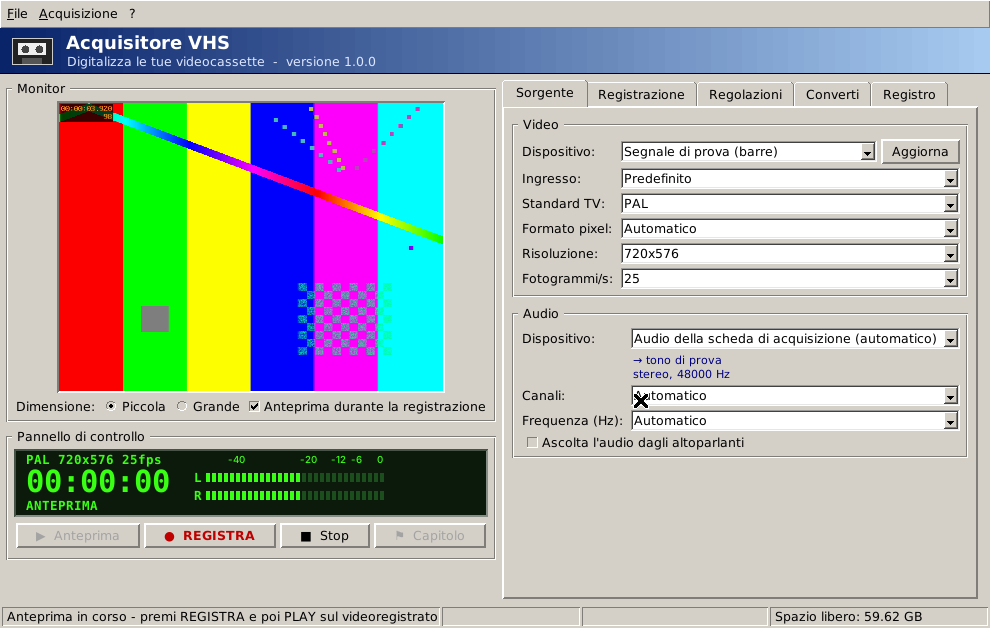

# Acquisitore VHS

Programma leggero per **digitalizzare videocassette** (VHS, VHS-C, Video8, Hi8...)
su Linux con le schede di acquisizione USB da composito/S-Video (EasyCAP,
UTV007, EM28xx, stk1160, MS2109 e simili) che il sistema vede come una webcam.

È pensato per **PC vecchi**: l'interfaccia, in stile programmi anni 2000, è in
Tkinter e il lavoro pesante lo fa **ffmpeg**. Non servono librerie grafiche moderne
né un'accelerazione 3D.



## Funzioni

- **Scelta della sorgente**: dispositivo video, ingresso (Composito / S-Video),
  standard TV (PAL, NTSC, SECAM...), formato pixel, risoluzione e fotogrammi al secondo.
- **Audio dalla scheda di acquisizione**: la voce predefinita è "Audio della scheda
  di acquisizione (automatico)". A ogni avvio il programma cerca l'ingresso audio che
  appartiene alla stessa periferica USB del video, quindi funziona anche se la
  numerazione delle schede audio cambia dopo un riavvio. Usa il formato nativo della
  scheda (canali e frequenza), attiva da solo l'ingresso di registrazione se la
  scheda parte muta e ne permette di regolare il volume nella scheda *Regolazioni*.
  Se l'audio della scheda non viene trovato, il programma lo segnala in rosso e
  chiede conferma prima di registrare senza audio. Si possono comunque scegliere
  a mano altre schede ALSA o sorgenti PulseAudio/PipeWire. C'è anche l'ascolto
  dagli altoparlanti.
- **Anteprima dal vivo** e **VU-meter a LED** con indicatore di CLIP.
- **Contatore stile videoregistratore**, dimensione del file, fotogrammi al secondo,
  fotogrammi persi o duplicati, spazio libero e **tempo di registrazione rimanente**.
- **Qualità**: MJPEG (poca CPU, consigliato per PC vecchi), H.264 veloce o
  compatto, FFV1 senza perdita per l'archivio, copia diretta per le schede MJPEG.
- Deinterlacciamento facoltativo (yadif/bwdif), formato 4:3 / 16:9, banda nera per
  nascondere il **rumore delle testine** in fondo al quadro.
- **Capitoli** (F8): i tempi vengono salvati accanto al video (`.capitoli.txt` e
  `.ffmetadata`).
- **Regolazioni dell'immagine** (luminosità, contrasto, saturazione, tinta) in
  tempo reale, ricordate per ogni scheda.
- **Arresto automatico** a fine nastro (schermo nero/blu), dopo una durata massima
  (E-180, E-240...) o con il disco quasi pieno.
- Scheda **Converti**: crea copie MP4 compatibili con TV e telefoni.
  - Usa la **codifica video della grafica Intel integrata** (VA-API / Quick Sync), molto
    più veloce del processore sui Celeron e Pentium (es. Lenovo B50-30). Il programma
    verifica all'avvio che funzioni; altrimenti usa il processore (x264).
  - Si può avviare **anche durante una registrazione**: gira a priorità minima e
    si mette in pausa da sola se la registrazione inizia a perdere fotogrammi.
  - Mostra velocità e tempo rimanente.
- Tutte le impostazioni vengono ricordate.

## Pensato per registrazioni di ore

Una cassetta può durare 3-4 ore (o 6-8 in LP), quindi la stabilità ha la precedenza
su tutto:

- **Il file è sempre leggibile**: il formato MKV resta leggibile fino all'ultimo
  secondo anche se il PC si spegne o si blocca.
- **Ripresa automatica**: se ffmpeg si interrompe o la scheda USB si blocca, un
  *watchdog* se ne accorge (nessun fotogramma per 20 s), riavvia l'acquisizione e
  continua in un nuovo file (`..._parte2.mkv`, `..._parte3.mkv`...). Il contatore
  prosegue e alla fine il registro elenca tutte le parti.
- **Anteprima, VU-meter e ascolto separati dalla registrazione**: se si guastano,
  la registrazione continua.
- **Niente sospensione**: durante la registrazione la sospensione automatica del PC
  viene bloccata (tramite `systemd-inhibit`).
- **Chiavette e dischi FAT32**: hanno un limite di 4 GB per file, quindi la
  registrazione viene divisa in automatico in file da 30 minuti. In alternativa
  si può scegliere di dividerla sempre (ogni 30 minuti / ogni ora).
- **Audio e video restano sincronizzati** anche dopo ore: frame rate costante e
  ricampionamento audio agganciato ai tempi del video.
- Il programma consuma poca memoria e non cresce nel tempo: il registro e i
  buffer hanno dimensione fissa.

## Installazione

```bash
git clone <questo repository> acquisitore
cd acquisitore
./install.sh
```

Lo script installa i pacchetti (`python3-tk`, `ffmpeg`, `v4l-utils`, `alsa-utils`,
`pulseaudio-utils`), aggiunge una voce al menu e aggiunge l'utente ai gruppi
`video` e `audio`. Dopo il primo uso bisogna uscire e rientrare nella sessione.

Senza installare, basta:

```bash
sudo apt install python3 python3-tk ffmpeg v4l-utils
python3 acquisitore.py
```

Requisiti: Python 3.6 o superiore e ffmpeg 4 o superiore.

Per vedere da terminale i dispositivi rilevati:

```bash
python3 acquisitore.py --elenco
```

## Uso rapido

1. Collega il videoregistratore alla scheda USB (giallo = video, bianco/rosso =
   audio; se c'è, usa l'S-Video).
2. Avvia il programma: l'anteprima parte da sola. Nella scheda **Sorgente**
   controlla dispositivo, ingresso e standard (PAL per le cassette italiane).
3. Nella scheda **Registrazione** scegli la cartella e il nome del file.
4. Premi **REGISTRA** (F9), poi **PLAY** sul videoregistratore.
5. Premi **Stop** (F10) alla fine, oppure lascia che si fermi da solo a fine nastro.

Se non hai ancora la scheda puoi provare tutto con "Segnale di prova".

## Consigli per i PC vecchi

- Usa **MJPEG**: richiede pochissima CPU. I file sono grandi (circa 3-6 GB per
  ora), ma puoi comprimerli dopo con **Converti**, magari di notte.
- Se la barra di stato segna **fotogrammi persi**, rimpicciolisci l'anteprima o
  togli la spunta a "Anteprima durante la registrazione" e chiudi gli altri programmi.
- Registra su un disco interno o USB formattato in ext4 o NTFS, se possibile.
- Non deinterlacciare durante l'acquisizione: lo fa la conversione.

## Risoluzione dei problemi

| Problema | Soluzione |
|---|---|
| Nessun dispositivo video | Ricollega la scheda e premi *Aggiorna*. Controlla con `lsusb` e `ls /dev/video*`. |
| "Permission denied" | `sudo usermod -aG video,audio $USER`, poi esci e rientra. |
| "Device or resource busy" | Chiudi gli altri programmi che usano la webcam o l'audio. Prova la sorgente PulseAudio/PipeWire. |
| Immagine in bianco e nero o che scorre | Standard TV sbagliato: scegli PAL (o NTSC) e 720x576 a 25 fps. |
| Nessun audio | Controlla che i cavi audio (bianco/rosso) vadano nella scheda USB. In *Sorgente* sotto "Audio" deve comparire il nome della scheda; poi alza il volume in *Regolazioni*. Con `python3 acquisitore.py --elenco` vedi quale audio è abbinato. |
| Audio distorto (CLIP) | Abbassa il volume dell'uscita del videoregistratore, se possibile, o il controllo "Volume audio" in *Regolazioni*. |

| Ogni tanto l'immagine diventa nera per un attimo | È la scheda di acquisizione che perde l'aggancio al segnale della cassetta (succede spesso con le schede economiche tipo MS2109/MS210x e con nastri o videoregistratori un po' instabili). Il registro e la barra di stato indicano quante volte succede ("buchi"). Pulisci le testine e regola il tracking; se possibile usa un videoregistratore con TBC/correzione del segnale o fai passare il segnale da un registratore DVD. Nella conversione i buchi vengono nascosti ripetendo l'ultima immagine buona. |
| Il video "scatta" | Alcune schede inviano 30 fotogrammi/s anche con le cassette PAL (25): il programma lo rileva e toglie solo i fotogrammi identici (doppioni), sia in registrazione sia in conversione. |
| Scatti occasionali, ogni volta in punti diversi | Il PC in quei momenti non tiene il passo. Collega l'alimentatore (a batteria il processore rallenta), chiudi browser e altri programmi, lascia l'anteprima piccola o disattivala, tieni il portatile ben ventilato. |
| Il VU-meter è sempre alto anche col volume basso | Alcune schede aggiungono una componente continua all'audio: viene rimossa automaticamente. |

I messaggi completi di ffmpeg sono nella scheda **Registro**.

## File

- `acquisitore.py`: il programma (un solo file, nessuna dipendenza Python esterna)
- `install.sh`: installazione per l'utente corrente
- Le impostazioni sono in `~/.config/acquisitore/impostazioni.json`
